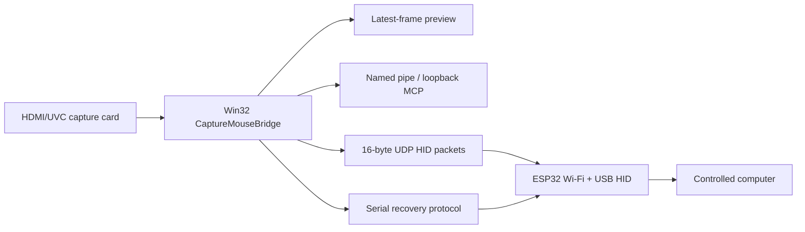

# Architecture

The desktop process owns capture, rendering, reconnect state, MCP, and transport selection. The ESP32 owns the final USB HID report and can operate through the configured Wi-Fi STA or its fallback AP. The UDP packet format is intentionally small and stable so the desktop can run at low latency without making the firmware depend on the Windows implementation.

The firmware has two independent safety paths:

- The serial path remains available for recovery and provisioning.
- The input watchdog releases all keys and buttons after inactivity.

MCP is an automation surface over the desktop state machine. It does not bypass the transport release logic or create a second HID state.
